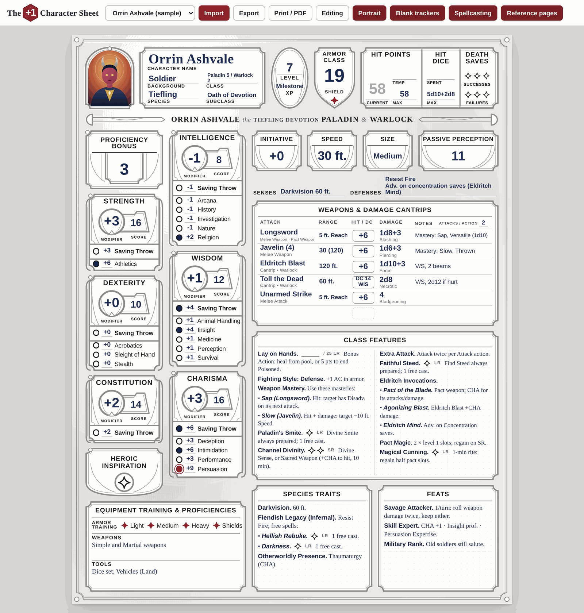
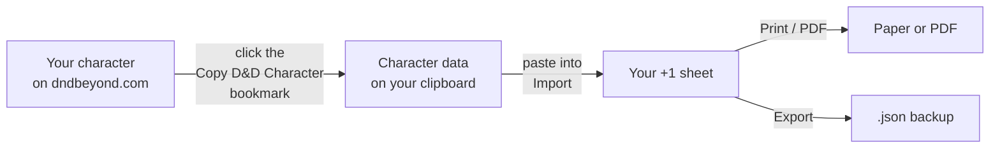
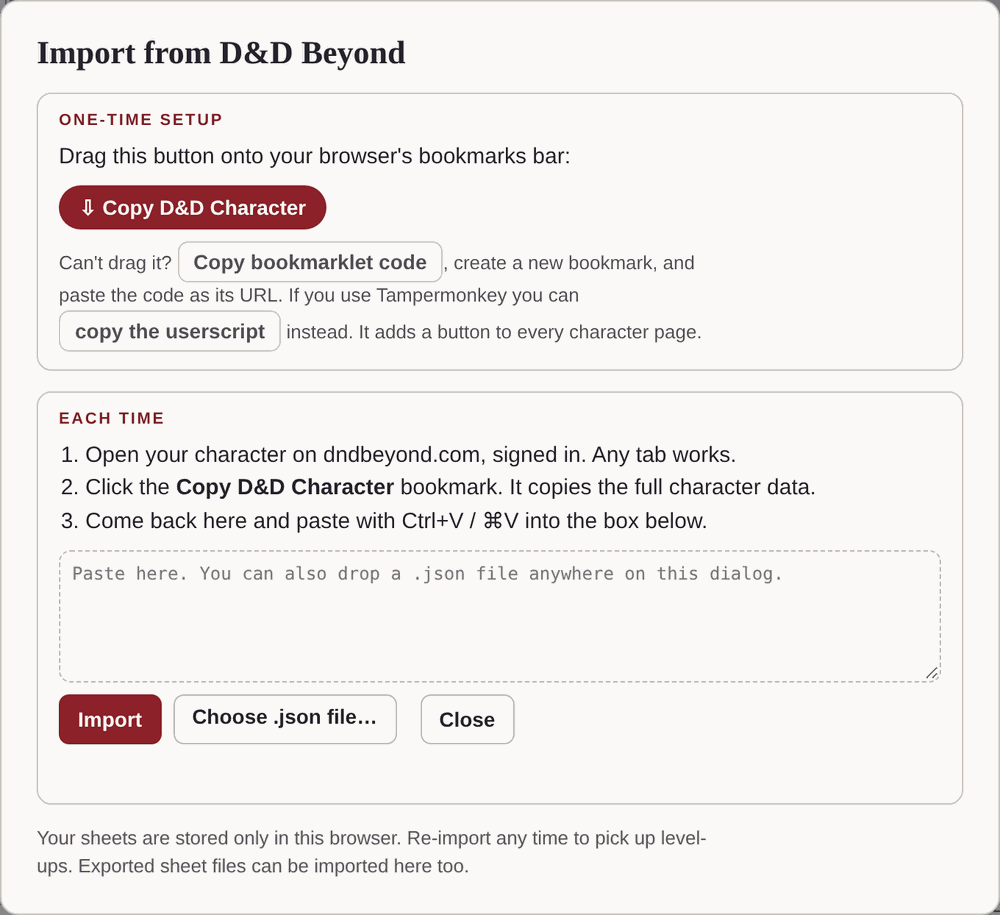
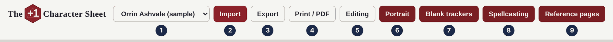
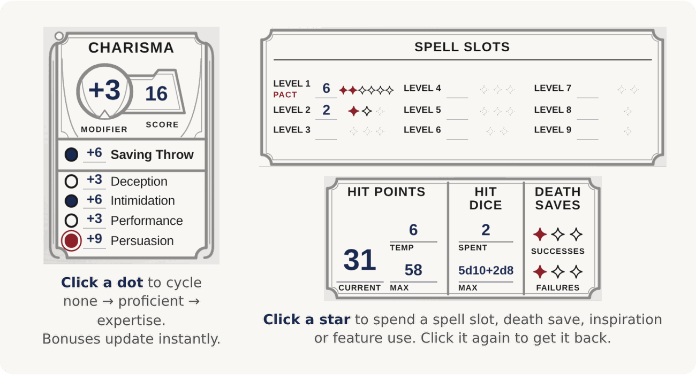
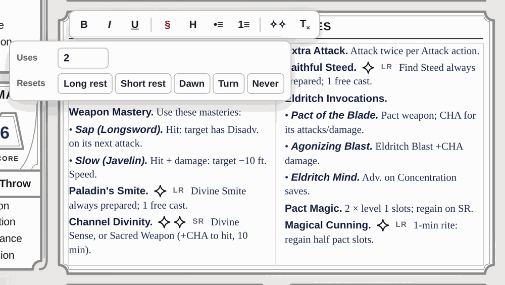
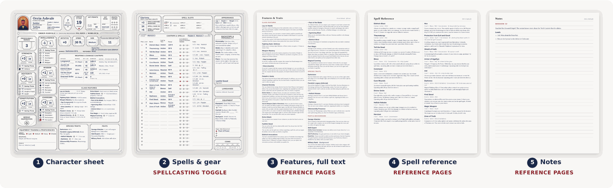
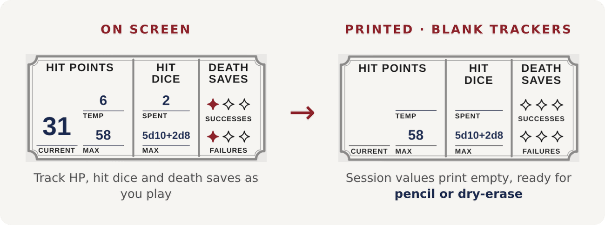

# The +1 Character Sheet

A D&D 2024 (5.5e) character sheet that **fills itself in from D&D Beyond**, tracks your session with a click, and **prints clean pages** for the table.

**▶ [Open the sheet](https://schultzisaiah.github.io/the-plus-one-character-sheet/)** (no sign-up, no install)

## Quick start

1. **Open the sheet.** A sample character loads so you can poke around. Changes to the sample aren't saved.
2. **Bring in your character.** Click **Import** to pull one from D&D Beyond, or choose **+ New blank sheet** in the character menu and fill it in by hand.
3. **Play.** Track things on screen, or click **Print / PDF** to get paper.

## Import from D&D Beyond

**One-time setup:** click **Import** and drag the **Copy D&D Character** button onto your bookmarks bar. (You can also copy the code into a bookmark by hand, or install it as a Tampermonkey userscript.)

**Each time:**

1. Open your character on dndbeyond.com while signed in.
2. Click the bookmark.
3. Come back and paste into the Import box.

Leveled up? Import again. It asks before replacing the existing sheet, and replacing it overwrites any edits you made to that character here.

 

## The toolbar

| # | Button | What it does |
|---|---|---|
| 1 | **Character menu** | Switch between your saved characters, or start a blank sheet |
| 2 | **Import** | Load a character from D&D Beyond or a `.json` file |
| 3 | **Export** | Copy or download your sheet as `.json` (a backup, or a way to move it to another computer) |
| 4 | **Print / PDF** | Print it, or choose "Save as PDF" in the print dialog |
| 5 | **Editing / Locked** | Lock the sheet so a stray click at the table can't change anything |
| 6 | **Portrait** | Show or hide the portrait. Click the picture to change it; drag to reposition |
| 7 | **Blank trackers** | Print HP, slots, coins and similar session values blank (see [Printing](#printing)) |
| 8 | **Spellcasting** | Show or hide the spell page (handy for martial characters) |
| 9 | **Reference pages** | Add full-text feature, spell and notes pages after the sheet |

## Everything is clickable

- **Type in any field.** Modifiers, saves, skills, initiative and passive Perception recalculate on their own. Changing your level updates your proficiency bonus.
- **Dots** cycle through none → proficient → expertise.
- **Stars** (✧) are uses: spell slots, death saves, Heroic Inspiration, feature charges and more. Click one to spend it and click it again to get it back.
- **Spells:** the Prep star marks a spell as prepared. **Shift-click** it to make the spell *always prepared*, so it doesn't count toward your limit. Hover between rows to insert or remove one. Extra pages are added as your list grows.

## Notes with built-in use trackers

Click into any text box (features, traits, equipment, backstory) and a formatting bar appears: **bold**, *italic*, headings, lists.

The **✧✧** button adds a use tracker anywhere in your text. Pick how many uses it has and when it resets (long rest, short rest, dawn, turn). Then:

- **Click** a star to use it
- **Shift-click** to add a star
- **Alt-click** to remove one

Copying and pasting keeps the trackers.

 

## Printing

Turn pages on or off to print exactly what you need:

With **Blank trackers** on, anything that changes during a session prints empty so you can fill it in with pencil or dry-erase. On screen, those values turn light grey to show which ones will be left blank.

## Where your sheets live

- Your sheets are saved **automatically, in this browser only**. Nothing is uploaded anywhere.
- If you switch browsers or computers, or clear your site data, your sheets won't come with you. Use **Export** to keep a backup, then **Import** the `.json` wherever you need it.

---

<b>Running or hosting it yourself</b>

The whole app is one file, `index.html`, with no build step and no dependencies. You can open it directly in any modern browser.

To host it on GitHub Pages: **Settings → Pages**, set **Source** to *Deploy from a branch*, choose `main` and `/ (root)`, then save. The `.nojekyll` file tells Pages to serve the files as they are.

